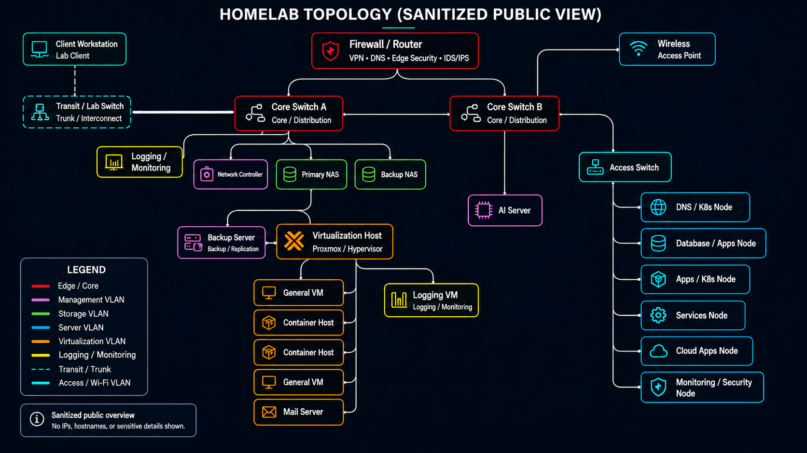
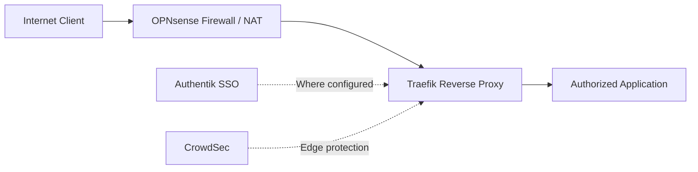

# Network Architecture

## Overview

The Castellum Homelab is a continuously operated, multi-host environment designed to develop practical experience in cybersecurity, network engineering, Linux administration, virtualization, and infrastructure operations.

The network combines physical servers, managed switching, wireless access, virtual machines, Linux containers, Docker workloads, and Kubernetes services. **OPNsense serves as the primary firewall and inter-VLAN routing point**, allowing traffic between network segments to be governed by firewall policy rather than relying on a single flat network.

My design priorities are:

- **Segmentation:** Organize devices and services by function and trust level.
- **Security:** Restrict unnecessary access to management systems and internal services.
- **Observability:** Collect host, application, firewall, and network-security telemetry.
- **Maintainability:** Keep service deployments and their dependencies understandable.
- **Recoverability:** Support infrastructure backups and restoration planning.
- **Hands-on learning:** Provide a controlled environment for testing and troubleshooting.

> **Public documentation note:** This is a sanitized architecture overview. Actual IP addresses, VLAN IDs, hostnames, switch-port assignments, credentials, and detailed firewall rules are intentionally excluded. The diagram illustrates major roles and logical relationships; it is not a complete physical cabling diagram. A functional grouping shown in the diagram does not necessarily represent a dedicated VLAN.

## Sanitized Network Diagram

## Network Organization

The environment uses OPNsense and managed switches to connect several network segments. The major segments and functional groups are summarized below.

| Segment or group | Role | Representative systems and services |
| --- | --- | --- |
| Management network | Infrastructure administration and management interfaces | Proxmox, switch/controller management, NAS management |
| Server network | Internal application and service workloads | Linux servers, Docker hosts, Kubernetes nodes, databases, DNS services |
| DMZ / public edge | Entry point for selected internet-facing services | Traefik reverse proxy and associated edge-security controls |
| Lab / transit networks | Networking practice, test systems, and lab interconnects | Test workstation, lab switching, Cisco networking equipment |
| Client / wireless networks | End-user and wireless connectivity | Workstations and wireless access points |
| Logging / monitoring | Security analytics and infrastructure visibility; a functional grouping across the environment | Graylog, Wazuh, Zabbix, ntopng, NetFlow telemetry |
| Storage | Shared data, media, and backup storage; a functional grouping | NAS systems, NFS services, Proxmox Backup Server |

The distinction between **network segments** and **functional groups** is intentional. For example, a monitoring application can run on a server or VM while receiving logs from several network segments. Likewise, a NAS management interface and its data-serving connections do not have to be represented as one dedicated storage VLAN.

## Core Infrastructure

### Firewall, routing, and VPN

OPNsense is the network's primary routing and security-control platform. It handles inter-VLAN routing, firewall policies, NAT for selected services, and WireGuard VPN connectivity. Keeping inter-segment routing at the firewall provides a consistent place to inspect and control traffic between trust zones.

Suricata IDS/IPS runs on **OPNsense**, inspecting traffic on the WAN interface. It is not a separate standalone IDS appliance in the current architecture. Firewall and network-security events are forwarded into the centralized logging environment for investigation.

### Switching and wireless access

Two managed Omada switches provide core/distribution connectivity, with additional access and lab switching downstream. An Omada controller supports network-device administration, while wireless access points provide client connectivity.

Tagged VLAN links carry the necessary segments between switching infrastructure and the firewall. A separate Cisco Layer 3 switch is also used for networking and lab exercises; this should not be confused with the primary OPNsense inter-VLAN routing design.

### Servers and virtualization

The homelab includes both dedicated physical hosts and virtualized workloads:

- **Proxmox VE:** Virtual machines and LXC containers for infrastructure and application services.
- **Debian Linux hosts:** Dedicated system services and Docker/Compose-based applications.
- **Kubernetes (K3s):** Selected containerized workloads and cluster-management experience.
- **Windows/Linux systems:** Endpoint administration, testing, and host security monitoring.

Different services use different deployment models based on operational requirements. Not every application runs in Kubernetes, and not every system requires its own virtual machine.

### Storage and backups

Shared storage is provided by NAS infrastructure, including OpenMediaVault and network file services. Proxmox Backup Server is used for virtualization backups, with an additional NAS-backed backup/synchronization arrangement.

Storage design considers performance, persistence, disk failure, backup retention, and recovery. The existence of backups is not treated as proof of recoverability; restoration testing and backup verification remain separate operational responsibilities.

## Important Traffic Flows

### 1. Internet-facing application access

Selected applications are made available through an edge ingress path rather than requiring each application to expose its own public listener.

Traefik provides HTTPS routing and certificate management using Cloudflare DNS-based certificate validation. CrowdSec contributes behavioral protection at the edge, and Authentik supplies identity and access controls for services where it has been integrated. The exact access-control path varies by application.

### 2. Internal service communication

Applications on one network segment may need access to a database, DNS resolver, or another internal service on a different segment. Such traffic is routed through OPNsense and evaluated against firewall policy.

A VLAN establishes a Layer 2 broadcast boundary; **firewall policy is what determines which inter-VLAN connections are permitted**. The goal is to permit necessary application dependencies without granting unrestricted access across the environment.

### 3. DNS resolution

Internal clients and services use Pi-hole-based DNS filtering, with upstream resolution through Unbound and DNS privacy components in the homelab's resolver chain.

Separating the DNS function from individual application deployments makes name resolution easier to administer, observe, and troubleshoot. Primary and secondary Pi-hole instances provide more than one internal DNS endpoint.

### 4. Security monitoring and log collection

The security-monitoring architecture brings together network and host telemetry rather than relying on a single product:

- **Suricata on OPNsense:** WAN traffic inspection and IDS/IPS events.
- **Graylog:** Centralized ingestion, search, analysis, and security event definitions for syslog, network, and application logs.
- **Wazuh:** Endpoint security telemetry, agent monitoring, and rule-based detections.
- **NetFlow and ntopng:** Network-flow collection, traffic analysis, bandwidth visibility, and communication-pattern monitoring.
- **Zabbix, Grafana, and Uptime Kuma:** Infrastructure health, visualization, and service availability monitoring.
- **n8n and notification services:** Selected alerting and automation workflows.

These products have complementary roles. They are not all directly connected to one another, and the network design does not assume every event passes through every platform.

### 5. Administrative and remote access

Administrative interfaces are logically distinguished from normal user-facing application traffic. WireGuard provides VPN access, while management and application access are governed by the relevant host and firewall controls.

Not all management interfaces are intended to be internet-accessible. Limiting management exposure is a key architectural objective.

## Security Design Principles

### Network segmentation

Separating management, servers, public-edge workloads, and lab/client traffic reduces unnecessary connectivity and helps limit lateral movement if a system is compromised. Segmentation is an additional control, not a substitute for host hardening or identity management.

### Defense in depth

The environment combines network-level controls, host firewalls, IDS/IPS, identity management, centralized logs, and endpoint monitoring. For example, OPNsense governs inter-network traffic while Wazuh and Graylog provide additional visibility into activity occurring on hosts and services.

### Restrained service exposure

Where practical, public web applications are routed through Traefik, and sensitive administrative functions remain internal or require an authorized access path. Public services, internal services, and management interfaces are treated as different exposure categories.

### Validation and troubleshooting

Network troubleshooting is performed across multiple layers: endpoint configuration, VLAN membership, switch connectivity, routes, firewall rules, DNS, TLS, and application health.

Common tools and evidence sources include `ip route`, `ip addr`, `ss`, `dig`, `traceroute`, `tcpdump`, OPNsense firewall logs, switch/controller information, and Graylog/Wazuh event searches. This helps distinguish a network-policy problem from a DNS, service, or application failure.

## Design Decisions and Lessons Learned

**Centralized routing policy.** I chose OPNsense as the principal inter-VLAN enforcement point so that communication between segments can be reviewed and controlled consistently. The tradeoff is that firewall changes and routing issues can affect several dependent services.

**Different deployment models for different workloads.** Physical hosts, virtual machines, LXC containers, Docker, and K3s all have places in the environment. The operational overhead of each is part of the design decision, rather than using one platform for everything.

**Monitoring must not disrupt the network.** A previous experiment moving Suricata inspection from the WAN interface to the LAN/VLAN trunk disrupted parts of the environment. Returning inspection to the stable WAN configuration restored the affected connectivity. This reinforced the importance of understanding packet paths and validating changes before broad deployment.

**A diagram is not a security control.** Network labels and VLANs are useful for organization, but the real security boundaries depend on correctly configured firewall rules, authenticated administration, host protections, and ongoing monitoring.

**Documentation is an operational tool.** Maintaining a public, sanitized architecture alongside private implementation details makes it easier to communicate design decisions without disclosing information that would unnecessarily expose the running environment.

## Current Scope and Ongoing Improvements

This is a working homelab, and the architecture continues to evolve. Ongoing work includes reviewing inter-segment access, improving alert quality, validating backups and restores, and keeping service and dependency documentation current.

This page documents the **overall design**. Application deployment details, security tuning, and individual troubleshooting cases are recorded separately in the project portfolio.

## Related Documentation

- [VLAN Segmentation](vlan-segmentation.md)
- [Service Catalog](../service-catalog.md)
- [Wazuh SIEM/XDR](../security/wazuh.md)
- [Portfolio README](../../README.md)
