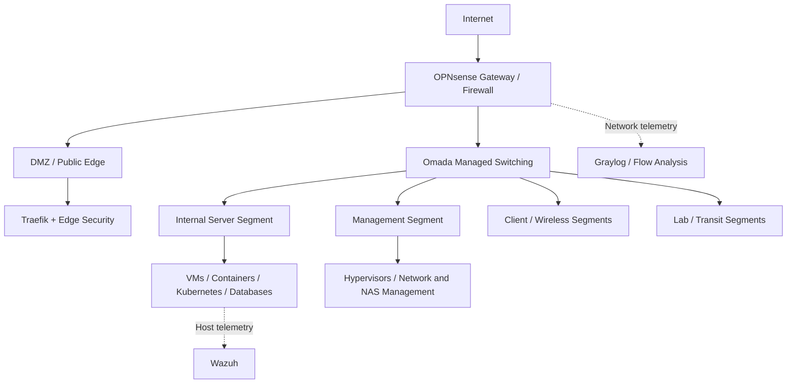
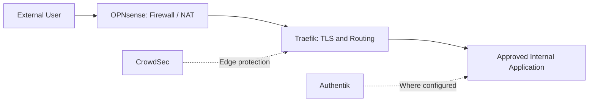
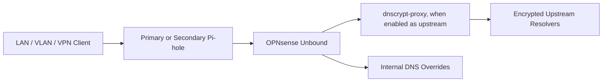
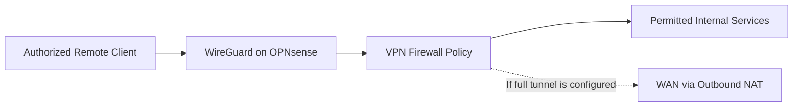
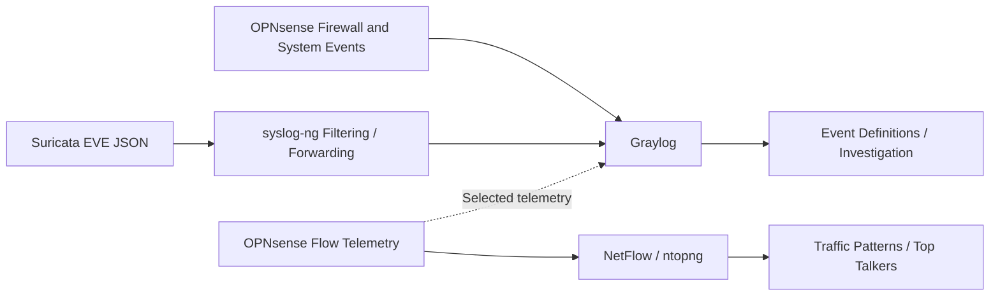

OPNsense Firewall, Network Segmentation & Security Operations
Project: Castellum Homelab — Network Perimeter and Internal Security Architecture
Platform: OPNsense / FreeBSD, Omada managed switching, Linux security services
Status: Active, continuously maintained
Period covered: Migration planning beginning in 2025 through operational improvements in November 2026
Focus: Firewall engineering, VLANs, DNS security, VPN, IDS/IPS, traffic visibility, incident troubleshooting
Public portfolio notice: This is a sanitized account of an operational homelab. Real IP addresses, public endpoints, VLAN IDs, hostnames, exact access-control rules, private keys, and management details are intentionally excluded. Diagrams are logical summaries, not complete physical wiring or firewall-policy exports. The configuration evolved over time; historical experiments are not necessarily part of the present deployment.

1. Project Overview
One of the most significant changes I made to my homelab was replacing the original Omada router/firewall with OPNsense as the dedicated gateway, firewall, and inter-VLAN routing platform. I retained the managed Omada switching and wireless infrastructure while moving Layer 3 routing, security policy, VPN services, and increasingly sophisticated traffic inspection to a firewall I could configure and investigate in much greater depth.

This project did not end when the new gateway could reach the internet. As the network grew to support servers, virtual machines, container hosts, Kubernetes, NAS systems, IoT devices, wireless networks, and a separate security lab, the gateway became the heart of the environment. Every additional service created new questions about segmentation, DNS behavior, service exposure, routing, log collection, and failure recovery.

My objective was to build and operate a network that behaves more like a managed small-enterprise environment than a single flat home LAN. The most valuable experience came from the failures, rollbacks, and subsequent validation—especially when security changes unexpectedly interfered with otherwise legitimate traffic.
2. Objectives and Design Requirements
- Replace the previous gateway while preserving the existing managed switching and wireless investment.
- Centralize inter-VLAN routing and policy enforcement on OPNsense.
- Separate infrastructure management, internal servers, public-facing services, wireless/IoT devices, and lab systems according to their roles and trust levels.
- Provide remotely accessible administration through WireGuard without broadly exposing internal management applications.
- Operate filtered internal DNS with local name resolution and privacy-oriented upstream resolution.
- Inspect relevant network traffic with Suricata IDS/IPS and distinguish detection from demonstrated prevention.
- Feed firewall, DNS, network-flow, and intrusion-detection telemetry into the broader security-monitoring environment.
- Maintain a practical path to diagnose and roll back disruptive configuration changes.
3. Environment and Technologies
Component	Role in the project
OPNsense	Main firewall, routing, NAT, VPN, Unbound, and Suricata platform
Omada managed switches	Layer 2 core/distribution switching, tagged VLAN transport, and access connectivity
Omada controller and access points	Switch/AP administration and wireless connectivity
Pi-hole (primary and secondary)	Internal DNS filtering and redundant resolver endpoints
Unbound	DNS caching, recursive/forwarding functions, and internal overrides
dnscrypt-proxy	Privacy-oriented encrypted upstream DNS when included in the active resolver path
WireGuard	Encrypted remote access to permitted homelab networks
Suricata	IDS/IPS traffic analysis on OPNsense
Graylog	Centralized firewall and Suricata log ingestion, search, and event analysis
NetFlow and ntopng	Flow-level traffic visibility and communication-pattern analysis
Wazuh	Complementary host-centric security monitoring and investigation
Traefik, CrowdSec, and Authentik	Reverse proxy, edge protection, and authentication controls for selected applications

The current design keeps inter-VLAN routing on OPNsense. The Omada switches provide managed Layer 2 connectivity; they are not represented here as the primary inter-VLAN security-policy enforcement point.
4. Architecture
Sanitized overall topology

This image shows the major infrastructure roles without exposing the actual production addressing and switch-port assignments. Functional categories such as storage or logging do not necessarily mean those systems occupy separate dedicated VLANs.
Logical security boundaries

This is a trust-zone view rather than a complete packet-path diagram. A route through OPNsense does not automatically mean traffic is permitted: applicable firewall policy still decides whether a connection can cross a boundary.
5. Migrating Away from the Omada Router
I began planning the move away from the Omada ER605 gateway in 2025. My goal was not to remove Omada from the entire network. The switches, wireless access points, and controller were still useful; I wanted a more capable and observable firewall/router while retaining the existing Layer 2 infrastructure.

The migration involved rethinking the gateway as a collection of dependencies instead of just replacing a hardware box:
1. Recreate the internal network and VLAN interfaces on the new gateway.
2. Make sure tagged networks continued to reach the correct firewall interfaces through the managed switching infrastructure.
3. Re-establish routing, DHCP-related settings, DNS, NAT, and required service-specific access.
4. Validate outbound connectivity separately from access between internal VLANs.
5. Restore remote access and any explicitly permitted inbound application paths.
6. Confirm critical services before considering the old gateway retired.
I learned that a gateway migration is successful only when all of the services depending on it still behave correctly. A machine being able to ping the internet does not establish that internal DNS overrides, VPN access, cross-VLAN application connections, or the reverse-proxy path work.
Key architectural decision
OPNsense became the network's central Layer 3 security boundary, while Omada remained the switching and wireless platform. This separated the responsibilities of switching/access from routing and firewall policy and gave me direct experience managing those boundaries.
6. VLAN Segmentation and Inter-VLAN Firewall Policy
I divided the environment into logical trust zones based on function and risk. The exact VLAN identifiers and addressing are intentionally omitted from this public report.
Network zone or function	Purpose	Security intent
Infrastructure management	Hypervisors, switch/controller management, NAS administration	Avoid treating management interfaces as ordinary application destinations
Internal servers	Linux hosts, databases, containerized applications, Kubernetes	Allow required application dependencies rather than unrestricted lateral access
DMZ / public edge	Reverse proxy and selected externally reachable services	Separate internet-facing ingress from internal management and data systems
Client and wireless	Workstations, wireless clients, connected devices	Keep endpoint and IoT traffic distinct from infrastructure administration
Lab and transit	Networking exercises, test hosts, and experimental configurations	Support learning while limiting unnecessary reachability into primary services
Logging/monitoring	Graylog, Wazuh, flow analysis, alerting (functional grouping)	Receive telemetry without implying unlimited access to all source networks
Storage	NAS and backup services (functional grouping)	Distinguish administrative access from authorized data/backup traffic

VLAN tagging creates Layer 2 separation; OPNsense rules determine allowed Layer 3 communication. I have used policy exceptions for specific dependencies such as DNS, VPN, application backends, and management, while treating unrestricted access between trust zones as something to avoid.
Lessons from rule ordering
The lab and restricted-wireless networks reinforced the importance of rule order. DNS and other explicitly authorized infrastructure services may need narrowly scoped exceptions before broader private-network restrictions. A broad block placed too early can make an otherwise sound design appear to have DNS or application failures.

I now test policy changes from the affected VLAN, check firewall logs, and verify both the intended allow and deny cases. This report intentionally does not publish a literal copy of the production ruleset.
7. NAT, Service Exposure, and Reverse Proxy
OPNsense controls WAN-facing policy and NAT for the environment. I have operated a hybrid outbound NAT configuration, including scenarios involving VPN clients, while using explicit inbound rules and forwarding only where needed.

For public-facing applications, the preferred separation is:

This keeps the firewall responsible for edge routing and policy while Traefik handles application-level HTTPS routing. Cloudflare DNS-based certificate validation is used by the reverse-proxy environment.
An unsuccessful alternative: reverse proxy on OPNsense
I also experimented with an OPNsense NGINX reverse-proxy configuration. The attempt produced repeated 404 behavior and virtual-host configuration-generation problems. Rather than continuing to modify a working application ingress setup, I abandoned the experiment and returned to the established Traefik-based design.

Lesson: The firewall does not need to host every security-related application function. Concentrating routing and policy on OPNsense and web ingress on Traefik reduced the number of unrelated failure modes I was changing at once.
8. DNS Architecture: Pi-hole, Unbound, and dnscrypt-proxy
DNS became one of the most involved parts of operating the firewall because nearly every service depends on it, including authentication, containers, application ingress, and remote clients.
Designed resolver chain

The design separates client-side filtering (Pi-hole), internal name resolution and caching (Unbound), and optional upstream DNS encryption (dnscrypt-proxy). Depending on the operational state, Unbound can resolve without forwarding to dnscrypt-proxy; this distinction mattered during incident recovery.
Internal DNS and split-horizon behavior
Some application names need to resolve to private reverse-proxy or service addresses from inside the homelab, while public DNS supplies the appropriate external records. I used Unbound overrides and Pi-hole forwarding to make internal service resolution work without routing every connection unnecessarily through the public path.

I tested DNS at each hop, rather than relying on a browser error alone:
- Does the client query the intended Pi-hole?
- Can Pi-hole reach and resolve through its upstream?
- Does Unbound return the correct internal override?
- Does Unbound resolve public names on its own?
- If encrypted forwarding is enabled, is dnscrypt-proxy actually listening and responding?
- Is the final result being affected by a client/browser cache rather than the DNS server?
Incident: dnscrypt-proxy startup dependency and widespread DNS failure
During a 2026 investigation, the network experienced DNS failures after Unbound had been configured to forward to a local dnscrypt-proxy listener that was not running after boot. Internal application problems and container DNS symptoms followed from the upstream resolver failure.

I tested Unbound and then temporarily disabled the unavailable forwarding dependency. Both external queries and internal overrides returned successful answers once Unbound was allowed to operate without that broken upstream path.

Further checks showed dnscrypt-proxy worked when started manually and listened on its configured localhost endpoint. That pointed to a service startup/ordering problem rather than a fundamentally invalid DNSCrypt resolver configuration. The boot-time integration still required separate attention; successful manual startup did not prove it would start reliably after every reboot.

Lesson: Adding privacy infrastructure can introduce a new single point of failure. I now distinguish DNS service health, upstream availability, and actual end-to-end resolver behavior before enabling or re-enabling forwarding.
Incident: stale DNS/HTTPS records misdiagnosed as application failure
On another occasion, internal DNS, direct HTTPS resolution, the reverse proxy, and the application backend could be validated, yet the browser still failed. A stale HTTPS/ECH-related DNS response at the client was a more plausible explanation than a broken Traefik route or certificate.

Lesson: Query the authoritative part of the path directly and test HTTPS with a controlled name-to-address mapping before rebuilding otherwise healthy infrastructure.
9. WireGuard Remote Access
WireGuard became the primary encrypted remote-access mechanism for the homelab. Moving to OPNsense required more than getting the tunnel interface up: the relevant peers also needed valid routes, DNS settings, inter-VLAN permissions, and—in full-tunnel scenarios—appropriate outbound NAT.

Issues and improvements
Early after the gateway migration, WireGuard connectivity and DNS did not work reliably until the client-side DNS and OPNsense settings were corrected. In one working configuration, adding the firewall's DNS endpoint alongside the internal Pi-hole resolver helped restore name resolution, although this also raised the question of whether clients were bypassing Pi-hole filtering.

For different VPN use cases, I learned to separate four independent tests:
1. Handshake: Is the peer connected and exchanging data?
2. Routing: Can the remote client reach its permitted internal destination?
3. Name resolution: Does the tunnel client resolve internal and public names correctly?
4. Outbound NAT: If using a full tunnel, does internet-bound traffic leave through the intended gateway?
A successful handshake by itself proves none of the other three. The experience improved my understanding of WireGuard AllowedIPs, firewall policy, DNS assignment, and outbound NAT interactions.
10. Suricata IDS/IPS on OPNsense
Suricata is integrated into the OPNsense firewall. It is not a separate standalone sensor in the current design. This matters for the portfolio because inspection mode, NAT visibility, NIC behavior, and enforcement all depend on where the engine runs.
Detection versus prevention
- Alert mode: A signature match can generate a security event without blocking the connection.
- IPS/Netmap mode: A configured rule can prevent traffic, but simply enabling IPS does not prove every matching signature is set to drop.
- Validation: Enforcement must be demonstrated with the relevant action/drop telemetry and expected test outcome—not inferred from the presence of alerts or a growing global drop counter.
Stable operational choice: WAN-only inspection
I experimented with extending Netmap IPS inspection from the WAN to the internal LAN interface that carries the VLAN trunk. That change disrupted wireless connectivity and several dependent services, including Ring and internal application monitoring.

Returning Suricata inspection to the WAN interface only restored the affected services. I kept that stable configuration rather than claiming LAN-trunk inspection was working reliably.

This was a major lesson in the interaction among NICs, VLAN tagging, packet capture modes, and inline security controls: the placement of an IPS is itself an availability and architecture decision.

There is an important tradeoff. WAN-side inspection can see traffic after NAT, which may obscure original internal source identity for some detections. I therefore use firewall logs, NetFlow, and host/security telemetry as complementary evidence when attributing events to internal devices.
Rule sources and policy tuning
I experimented with commercial/community and open threat-intelligence signatures, including Emerging Threats categories and abuse.ch/other reputation feeds. Simply downloading more signatures did not automatically improve security.

Two investigations demonstrated why enforcement changes must be carefully tested:

Feodo alert-to-drop change: Switching a small Feodo signature policy from alert to drop coincided with a loss of internet-bound connectivity, while the local firewall and LAN remained reachable. Reverting the policy to alert restored connectivity. The observation established a useful rollback, but did not by itself prove exactly which packet or signature caused the interruption.

Additional SID drop tests and DNSCrypt disruption: Enabling drop for selected signatures coincided with a DNSCrypt outage. Reverting them and restarting DNSCrypt restored service, but later evidence did not establish that those exact rules had matched the affected traffic. IPS reload/link effects and DNS service availability were alternative explanations. I therefore treated causation as unconfirmed rather than documenting a false root cause.
Signature compatibility after an upgrade
Following an OPNsense/Suricata upgrade in late October 2026, several Snort VRT signatures failed parsing because their rule syntax was not accepted by the installed Suricata engine.

I identified the incompatible signatures, disabled nine affected SIDs, and validated the remaining configuration with:
suricata -T --init-errors-fatal
The configuration test completed successfully, subsequent reloads succeeded, and the previously observed parsing errors were absent from the verified post-remediation log window.

The tradeoff was explicit: disabling incompatible rules restored engine health, but those particular detections were no longer active. A clean startup is not the same as full signature coverage.
Known authorized traffic and false positives
Some traffic patterns—such as known, intentionally operated mining workloads—can legitimately resemble suspicious activity. I learned to evaluate these alerts against confirmed source systems and destinations rather than globally treating all traffic of that type as harmless.

Rule tuning must preserve the ability to investigate unfamiliar sources, destinations, or changed behavior.
11. Logging, NetFlow, and Security Visibility
Running a firewall without collecting useful evidence would have limited the value of this project. I connected OPNsense telemetry to the wider monitoring environment, especially Graylog, and used NetFlow/ntopng for traffic visibility.

Suricata EVE forwarding
I worked with syslog-ng to read structured events from Suricata's EVE JSON log and forward selected event types into a dedicated Graylog ingestion path. This supported analysis of TLS metadata and drop events while keeping the broader firewall/system logging pipeline separate.

I also had to account for duplicate ingestion. When the same Suricata events were available through native syslog output and an EVE-file-forwarding path, leaving both enabled could create redundant records. The solution was to make forwarding responsibilities explicit, retain the required structured events, and avoid double-sending the same content.
Allowed alerts are not necessarily blocked traffic
In IPS investigations, some signature matches appeared with an allowed action. I learned not to present these as prevented intrusions. Likewise, some low-level stream-validation drops can contribute to IPS counters without demonstrating that a malware signature blocked a connection.

For a security investigation, I distinguish:
- Signature matches that were allowed
- Signature matches that were actually blocked
- Stream/decoder-related drops
- Firewall-policy blocks
- Application or DNS failures that happened around an IPS reload but may have unrelated causes
This distinction became especially valuable when tuning Graylog alert definitions and interpreting the effect of security-policy changes.
NetFlow and ntopng
Flow monitoring adds a different perspective from packet signatures and ordinary syslog. I use NetFlow and ntopng to examine communicating endpoints, traffic volume, connections, and general traffic patterns. This helps establish normal activity and provides investigative context for a suspicious alert without assuming that a single tool can explain every network event.
12. Selected Troubleshooting Case Studies
Investigation	Symptom	What I did	Result / lesson
Gateway migration	Routing and DNS dependencies changed after replacing the Omada gateway	Separated VLAN, DNS, NAT, VPN, and application checks	Gateway replacement required dependency-by-dependency validation
VPN name resolution	Tunnel connected but services did not resolve correctly	Tested client DNS assignment and resolver behavior	Restored working access; identified potential Pi-hole bypass tradeoffs
DNSCrypt boot/startup	Public DNS failed when Unbound forwarded to an unavailable local service	Bypassed broken forwarding, verified Unbound, and manually checked DNSCrypt listener	Resolver functionality recovered; boot reliability remained a separate concern
Browser-only HTTPS failure	Browser failed despite working reverse-proxy and backend tests	Compared direct DNS and controlled HTTPS responses	Avoided unnecessary changes to healthy infrastructure
Suricata on LAN trunk	Wi-Fi, connected devices, and applications became unavailable	Reverted Netmap inspection to the stable WAN interface	Connectivity restored; placement and NIC compatibility mattered
Threat-intel drop policy	Internet connectivity failed after a prevention-policy change	Reverted Feodo policy and examined surrounding behavior	Availability restored; exact packet-level cause not proven
Suricata parser failure	Rules failed after an engine/signature update	Disabled nine incompatible SIDs and ran strict configuration validation	Healthy reloads; documented loss of affected detection coverage
Duplicate EVE ingestion	Same security activity risked appearing more than once	Separated event-forwarding responsibilities in syslog-ng/native output	Clearer log ownership and less misleading event volume
Reverse-proxy experiment	OPNsense NGINX virtual-host behavior did not match expectations	Returned to working Traefik-based ingress	Preserved a useful separation between firewalling and application routing

An operational practice that changed
I no longer treat a working GUI or a successful service restart as conclusive proof. Following changes to core networking services, I validate end-to-end flows from the affected network and check whether the relevant logs agree with what users and applications actually experience.
13. Validation and Diagnostic Toolkit
I use a layered workflow: physical/link state, VLAN membership, IP addressing, routing, firewall policy, DNS, VPN, and finally the application. Depending on the host, useful checks include:
On OPNsense / FreeBSD
netstat -rn
pfctl -sr
pfctl -sn
wg show
sockstat -4 -l
On a Linux client or server
ip addr
ip route
resolvectl status
dig example.com
traceroute example.com
ss -lntup
IDS/IPS validation
suricata -T --init-errors-fatal
I complement these commands with OPNsense firewall live logs, interface status, Unbound/DNSCrypt service logs, Suricata EVE JSON, Graylog searches, and targeted packet captures. These are representative diagnostic commands, not a complete reproducible firewall configuration.
What I verify after high-risk changes
1. The gateway, switches, and critical infrastructure remain reachable.
2. Representative clients on each affected network can reach permitted destinations.
3. Restricted networks are still blocked from destinations they should not access.
4. Internal DNS overrides and external DNS resolution both work.
5. WireGuard handshake, routing, and DNS behave as expected.
6. Reverse-proxied applications remain reachable through their normal HTTPS path.
7. Suricata runs, parses its rules, and generates the expected telemetry.
8. Graylog and flow-monitoring systems continue receiving useful events.
14. Outcomes
The project evolved from a gateway replacement into a continuously operated network-security platform. The key outcomes are:
- Migrated gateway, firewall, NAT, inter-VLAN routing, and VPN responsibilities to OPNsense while retaining Omada switching and wireless infrastructure.
- Built a multi-zone network that separates key infrastructure and application functions and allows policy decisions at a central routing point.
- Established internal DNS filtering and split-horizon resolution with Pi-hole and Unbound, and investigated the operational risks of adding encrypted upstream DNS.
- Operated WireGuard remote access and worked through DNS, routing, and NAT dependencies.
- Integrated Suricata IDS/IPS into OPNsense, learned to distinguish alerts from proven blocks, and established a stable WAN-only inspection configuration after an unsuccessful LAN-trunk experiment.
- Investigated signature compatibility, rule tuning, telemetry duplication, and the effect of aggressive prevention policies on legitimate traffic.
- Connected firewall and intrusion-detection telemetry to centralized analysis and added flow-based visibility through NetFlow/ntopng.
- Developed a repeatable, evidence-based approach to debugging changes that affect multiple services.
This is an actively evolving lab, not a claim that all controls are perfectly tuned or all failure modes have been eliminated.
15. Skills Demonstrated
- OPNsense and FreeBSD administration
- Firewall rule evaluation and policy troubleshooting
- VLAN design and 802.1Q trunking
- Inter-VLAN routing and segmentation
- NAT and reverse-proxy traffic-flow analysis
- WireGuard VPN administration
- DNS filtering, Unbound, split DNS, and encrypted resolver troubleshooting
- Suricata IDS/IPS, Netmap, and signature management
- Network telemetry, NetFlow, Graylog, and security event interpretation
- Linux networking and cross-platform troubleshooting
- Incident response, controlled rollback, and post-change validation
- Technical documentation and security architecture communication
16. Lessons Learned
A firewall is a dependency for the entire environment. A small change to DNS, routing, NAT, or an inline IDS/IPS can interrupt seemingly unrelated services. Changes must be staged and validated with that impact in mind.

Segmentation requires policy, not just VLAN labels. VLANs organize Layer 2 traffic, but the security outcome depends on explicit Layer 3 rules, exceptions, and verification.

Encrypted DNS is not automatically resilient DNS. An extra forwarding dependency can improve privacy while reducing availability if startup order and recovery behavior are not understood.

IPS prevention must be demonstrated, not assumed. A signature alert, a configured drop policy, and actual packet blocking are different things. When a network outage accompanies a policy reload, I need evidence before attributing causation to a specific signature.

Stable architecture is preferable to feature accumulation. Reverting unsuccessful LAN Netmap inspection and an OPNsense NGINX experiment was progress: it preserved availability while clarifying which components should perform which roles.

Logs are only as good as their pipeline. Duplicate events, unclear action fields, NAT-translated addresses, and stream errors can all lead to incorrect incident conclusions if they are not interpreted in context.

Rollback is part of engineering. Several of my strongest learning experiences came from restoring service quickly, isolating the failed assumption, and improving the next testing procedure.
17. Future Improvements
- Continue reviewing rule scope and documenting representative allow/deny validation for each trust zone.
- Test DNSCrypt startup behavior after upgrades and reboots before treating encrypted upstream forwarding as a dependable default.
- Expand repeatable, low-risk IPS rule testing and retain clear evidence for actual prevention events.
- Improve backup and restore exercises for firewall configurations and critical DNS dependencies.
- Track meaningful availability and detection-coverage metrics rather than relying only on raw alert counts.
- Keep public diagrams and portfolio documentation updated as routing, DNS, and security integrations change.
18. Related Projects
- [Network Architecture](../architecture/network-design.md)
- [VLAN Segmentation](../architecture/vlan-segmentation.md)
- [Graylog Centralized Logging](../security/graylog.md)
- [Wazuh SIEM/XDR](../security/wazuh.md)
- [Proxmox Virtualization](../infrastructure/proxmox.md)
  
Technical References
- OPNsense — Intrusion Prevention System
- OPNsense — Unbound DNS
- OPNsense — DNSCrypt-Proxy
- OPNsense — WireGuard Road Warrior Setup
This page documents practical work performed in my homelab. It is not a turn-key configuration guide or an exported production firewall policy.
