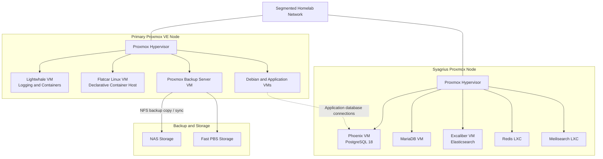

Proxmox VE — Virtualization, Flatcar Linux, and Centralized Infrastructure
Objective
I built and expanded a multi-host Proxmox Virtual Environment (PVE) to support an increasingly complex cybersecurity and infrastructure homelab. My goal was to move beyond installing individual applications and learn how to design, operate, monitor, troubleshoot, and recover virtualized infrastructure that other services depend on.

The environment evolved into two Proxmox hosts with different responsibilities:
- Primary PVE node: General-purpose virtualization, Docker and Flatcar Linux workloads, a dedicated logging VM, and Proxmox Backup Server.
- Syagrius node: Centralized data services, including PostgreSQL, MariaDB, Elasticsearch, Redis, and Meilisearch.
This separation helps me reason about resource allocation, storage I/O, network dependencies, database administration, backup design, and the operational consequences of a host failure. These are independently managed infrastructure roles; the design should not be interpreted as a verified high-availability cluster or automatic failover solution.
Environment
Component	Implementation	Primary purpose
Primary hypervisor	MINISFORUM MS-A2; AMD Ryzen 9 9955HX; 96 GB RAM	General-purpose VMs, container hosts, and backup services
Primary host storage	Two 2 TB NVMe SSDs with separate Proxmox storage pools	Separate host/VM storage from selected high-I/O workloads
Secondary hypervisor	HP EliteDesk 800 G4 DM; Intel Core i5-8500; 64 GB RAM	Centralized database and search services
Virtualization	Proxmox VE, QEMU/KVM, LXC, VirtIO	VM and system-container administration
Guest operating systems	Debian Linux and Flatcar Container Linux, among others	General Linux services and specialized container workloads
Container runtime	Docker and Docker Compose inside appropriate guests	Application isolation and lifecycle management
Data platforms	PostgreSQL 18, MariaDB, Elasticsearch, Redis, Meilisearch	Shared persistence, indexing, caching, and search
Backup	Proxmox Backup Server (PBS), NAS-backed storage	Guest backups and backup-copy workflows
Monitoring/inventory	Zabbix, infrastructure telemetry, NetBox	Operations visibility and asset relationships

The hardware specifications reflect the documented configuration as the lab evolved. Individual VM allocations and the workload inventory change as projects are added or migrated.
Architecture
The diagram shows logical responsibilities, not physical switch ports, real IP addresses, or every guest in the environment.

Architecture note: A diagram edge represents a logical relationship, not proof that a workload uses a dedicated cable or VLAN. Specific application-to-database connections depend on the service; not every application uses PostgreSQL.
Design Decisions
Two Hosts with Different Roles
The primary PVE host has the greater CPU and memory capacity and is suited to general virtualization, experimentation, and mixed workloads. Syagrius provides a more focused tier for databases, search, and supporting infrastructure.

I chose to run database engines inside guests rather than directly on the Proxmox hypervisor. This keeps the hypervisor focused on virtualization and gives each service a clearer operating-system boundary, resource allocation, upgrade path, and backup scope.

The design also creates dependencies that must be understood: centralizing databases simplifies administration but means that a Syagrius outage can affect applications running on other physical hosts. Resource separation is not the same as high availability.
NVMe Storage and Workload Placement
The primary host uses separate NVMe-backed storage pools. I placed the Lightwhale logging guest on a dedicated VM storage pool rather than treating every virtual disk as interchangeable.

This decision followed real workload observations. Search, logging, and container workloads can produce substantial disk I/O, even when CPU and memory usage appear normal. Separating storage placement makes it easier to investigate contention and plan capacity.

A separate removable USB disk has also been used for local backup-related storage. I do not treat a locally attached disk as equivalent to an independent off-host recovery copy.
Networking and Security Boundaries
Guests connect to the existing segmented homelab through Proxmox virtual bridges and tagged interfaces where appropriate. OPNsense enforces the environment's inter-VLAN routing and firewall policy. Database, management, application, and logging functions are documented separately without publishing their live addresses or port exposure.

Virtualization does not remove the need for host hardening, guest firewalls, service-level authentication, or network-access restrictions.
Primary PVE Node — General Virtualization
The main hypervisor has hosted several classes of workloads, including Debian application VMs, Docker-oriented guests, a Flatcar Linux VM, the Lightwhale logging VM, and a PBS VM. Some guests were dedicated to a specific application, while others provided a reusable base for testing services and operating systems.

Key operational practices include:
- Allocating vCPU, RAM, virtual disks, and virtual NICs according to workload requirements.
- Using VirtIO devices where supported and checking guest behavior rather than assuming defaults are optimal.
- Keeping the Proxmox host separate from the applications running in its guests.
- Monitoring storage capacity, thin-pool use, guest performance, and unexpected I/O.
- Maintaining clear VM names, descriptions, tags, and inventory relationships.
- Investigating host-level faults separately from guest-level failures.
Flatcar Container Linux — Declarative Provisioning
Flatcar was an important change from my usual Debian-plus-Docker approach. Instead of treating a VM as a manually configured general-purpose Linux server, I learned to manage a container-oriented operating system through Butane configuration, Ignition provisioning, and systemd units.
Implementation
I created the Flatcar VM under Proxmox and used a Butane source configuration to generate an Ignition file. The provisioning workflow connected the guest's initial configuration to Proxmox through a custom Cloud-Init/Ignition snippet.

The application configuration included persistent host directories, environment files, Docker execution through systemd, and service restart behavior. The configuration could be revised and regenerated rather than relying solely on undocumented manual changes.
Butane source configuration
          |
          v
Butane validation and conversion
          |
          v
Ignition configuration
          |
          v
Proxmox guest provisioning
          |
          v
systemd-managed Docker workload
Application Changes and Troubleshooting
Flatcar initially hosted application experiments that included Open Notebook and SurrealDB. As the lab evolved, I removed those services from this VM, cleaned up their units and related resources, and moved the Open Notebook workload to the separate GPU-equipped AI host.

The Flatcar guest was then streamlined to host Blinko, with Docker controlled through an enabled systemd unit and persistent application storage on the guest. During the change, I diagnosed a database-access problem involving an external PostgreSQL service on another host, confirmed Blinko started successfully, and updated the reverse-proxy target. That database was separate from the Phoenix/Syagrius database tier in the recorded setup.

I also reclaimed several gigabytes of unused Docker data during cleanup. The main lesson was that a small, declaratively configured container host is easier to understand when obsolete units, images, and storage are removed deliberately.
Skills Demonstrated
Flatcar gave me experience with immutable/container-focused Linux, declarative provisioning, Butane and Ignition, systemd service definitions, Docker persistence, troubleshooting service dependencies, and controlled workload migration.
Lightwhale — Logging and High-I/O Virtual Machine
The Lightwhale guest became an especially useful lesson in storage isolation and performance analysis. It was configured with a substantial virtual disk on the primary host's second NVMe-backed VM storage pool. A documented configuration used a 500 GB virtual disk, with persistent Docker and Graylog-related storage on that guest; the guest's persistent filesystem has also been examined at the Btrfs layer.
Resource and Storage Investigation
I investigated episodes of unusually heavy guest storage activity. In one captured incident, the logging VM was associated with approximately 177 MB/s of disk I/O and substantial network traffic. During the broader event, commands to a separate backup guest timed out. That correlation prompted investigation of disk queues, guest-level processes, LVM-thin storage, and shared I/O pressure.

I compared the event with backup schedules, disk SMART information, storage pool health, and guest activity rather than immediately assuming SSD failure. The storage hardware checks were reassuring; the exact cause of every observed performance spike was not conclusively established.

This investigation reinforced the difference between observing a bottleneck, identifying a likely workload, and proving a root cause. I also evaluated a smaller replacement disk and data-migration approach for Lightwhale instead of attempting an unsafe in-place shrink of its existing virtual disk. That was a migration plan, not a completed migration.
Application-Level Troubleshooting
Lightwhale also hosted a containerized browser workload that stopped functioning correctly after an image update. Rolling back to a known-working image restored service. I investigated CPU-instruction exposure and virtual CPU configuration as possible contributors, without treating those hypotheses as proven causes.

The lesson was to distinguish application image regressions from faults in the VM, Proxmox, or physical CPU.
Syagrius — Centralized Database and Search Node
Syagrius is the secondary Proxmox host built around an HP EliteDesk mini PC. I use it to consolidate data-oriented infrastructure that would otherwise be spread across many individual application servers.

The documented workload set includes:
Guest	Technology	Responsibility
Phoenix	PostgreSQL 18 VM	Central relational database server for multiple applications
MariaDB	MariaDB VM	Centralized MySQL-compatible relational database services
Excaliber	Elasticsearch VM	Full-text indexing and search services
Redis	LXC	Shared in-memory datastore/cache workloads
Meilisearch	LXC	Application search/indexing services

At one recorded point, Phoenix was allocated 12 GB RAM, Excaliber 16 GB, and MariaDB 6 GB. Those are examples of actual guest sizing, not guaranteed current allocations or a universal recommendation.
Why I Centralized Data Services
Initially, many self-hosted applications brought their own databases or local persistence. Consolidation created an opportunity to learn database lifecycle management beyond simply getting an application to start.

The responsibilities now include client configuration, firewall access, TLS trust, database and role provisioning, application migration, indexing, resource monitoring, backup design, and dependency troubleshooting.

Centralization has tradeoffs: fewer duplicated database installations and clearer administration, but greater shared-service impact during maintenance or outages. I treat that as an architectural risk to manage rather than an automatic improvement in reliability.
Phoenix — PostgreSQL 18 Administration
Phoenix became a common PostgreSQL service for applications across the homelab. Documented database clients have included n8n, Gitea, FreshRSS, Termix, PatchMon, plMail, Hister, Dockhand, Grist, and other self-hosted tools.
Database Administration and Tuning
I worked with database roles, pg_hba.conf client restrictions, connection limits, and TLS-capable client connections. I also enabled pg_stat_statements to support query-level performance observation.

One recorded tuning state included:
Setting	Recorded value	Purpose
shared_buffers	2 GB	PostgreSQL buffer cache
effective_cache_size	7 GB	Planner estimate of available caching
maintenance_work_mem	256 MB	Maintenance operations
max_connections	100	Connection capacity limit
max_wal_size	2 GB	WAL growth before checkpoint pressure
checkpoint_timeout	15 minutes	Checkpoint scheduling limit

These values describe a tested configuration, not generic production tuning advice. After applying the changes, I verified PostgreSQL restarted successfully and had no pending configuration restart.
TLS and Certificate Troubleshooting
Moving application databases to Phoenix exposed a problem that is easy to miss during initial setup: a working encrypted connection is not necessarily a correctly verified server identity.

I encountered a hostname-verification failure when a client connected using an IP address that did not match the PostgreSQL certificate's DNS subject alternative name. I also investigated a certificate deployment/configuration issue involving file access. The proper design is to use a trusted internal CA, a DNS name matching the certificate, and appropriate client verification rather than bypassing identity checks to hide the problem.

I later verified a VaulTLS-issued server certificate and its matching private key, and documented applications using encrypted PostgreSQL connections. I do not claim that every database client had completed full certificate verification at the same time.

This work helped me understand TLS as a chain of dependent requirements: certificate issuance, SAN matching, DNS, trusted CA distribution, file permissions, server configuration, and client connection parameters.
Application Dependency Troubleshooting
Database consolidation also required diagnosing application startup failures and migration delays. For example, an application's failed PostgreSQL migration could surface as a container startup timeout even when the broader network remained reachable. I learned to examine application logs, database readiness, authorization rules, and the actual connection path before changing unrelated network settings.
Excaliber, MariaDB, Redis, and Meilisearch
Excaliber runs Elasticsearch as a dedicated search service. I validated an application integration using Nextcloud full-text search and worked through the consequences of separating a search engine from the application that consumes it. Resource placement, version compatibility, indexing, and monitoring became independent operational concerns.

MariaDB runs as a dedicated VM rather than on the Proxmox host. Redis and Meilisearch use LXC guests, providing a chance to compare full virtual machines with system containers: stronger guest OS separation and different kernel boundaries on one hand, versus lower resource overhead and simpler small-service deployment on the other.

These guests illustrate the importance of choosing a deployment model based on operational requirements, not using VMs or LXC exclusively for everything.
Troubleshooting Case Studies
1. Primary Proxmox Host Unexpected Shutdown
Problem: The main Proxmox server experienced an unclean crash and required a hard reset.

Investigation: I reviewed the preceding kernel and system journal, hardware error indicators, NVMe SMART data, temperature readings, and whether the host had logged an OOM event, kernel panic, or persistent storage fault.

Outcome: The available evidence did not establish a definitive hardware or software root cause. Power-state/ACPI behavior was considered, and sleep/hibernate restrictions were applied. Other PCIe power-management changes were evaluated as possible mitigations, not proven fixes.

Lesson: A clean SMART report or absence of a panic does not prove a system is healthy. Reliable troubleshooting means documenting what the evidence rules out and what remains uncertain.
2. Syagrius Network Instability and Reduced Link Speed
Problem: The secondary hypervisor experienced network interruptions and Intel Ethernet driver hardware-hang messages. At one point, its network connection negotiated only 100 Mb/s, despite gigabit-capable equipment.

Investigation: I reviewed interface and driver logs, Proxmox/cluster-related connectivity symptoms, link negotiation, and physical cable/keystone paths. I also examined offload features such as TSO and GSO.

Action and outcome: Disabling TSO/GSO was applied as a driver mitigation. Bypassing an intermediate keystone/cable path restored a 1 Gb/s negotiated link, strongly implicating the physical network path in the speed problem. The driver-hang and physical-link findings should not be conflated into one conclusively proven root cause.

Lesson: Virtualization failures can originate below the hypervisor—from NIC drivers, offloads, link negotiation, or cabling—and cascade into guest and management-service symptoms.
3. Flatcar Provisioning and Service Cleanup
Problem: Application experiments left Flatcar with service definitions and Docker resources that no longer matched its intended purpose.

Action: I revised the Butane/Ignition configuration, removed obsolete systemd units, migrated workloads to their appropriate hosts, cleaned unused Docker resources, and verified the remaining application service.

Outcome: Flatcar became a smaller, clearer Blinko container host.

Lesson: Declarative infrastructure still requires disciplined state cleanup and validation after workload changes.
4. Lightwhale Disk I/O and Backup-Guest Responsiveness
Problem: A high-I/O logging workload coincided with delayed responses from another guest.

Action: I examined virtual disk placement, LVM-thin utilization, hardware health, backup timing, and guest-generated I/O.

Outcome: The investigation characterized the event and excluded several obvious hardware explanations, but did not conclusively prove every component of the performance chain.

Lesson: Shared storage contention can produce symptoms in unrelated VMs. Capacity, throughput, latency, and backup schedules all matter.
5. PostgreSQL TLS Identity Mismatch
Problem: A database client failed certificate hostname verification.

Action: I compared the requested connection endpoint with the certificate SAN, then checked the internal CA, server certificate/key, and client TLS configuration.

Outcome: I established the correct DNS-and-certificate design and verified certificate/key consistency. TLS client rollout has been incremental.

Lesson: Secure connectivity requires validating the intended identity, not just enabling encryption.
6. Proxmox Backup Server and NAS I/O Pressure
Problem: Garbage collection against the NAS-backed PBS datastore consumed extensive time and I/O. A recorded run exceeded 20 hours and was interrupted before completion. Further monitoring showed high disk utilization on the shared NAS array.

Investigation: I checked PBS task progress, datastore size, chunk/index counts, NFS mounts, RAID status, and competing NAS workloads. The NAS array remained healthy during the checks; the performance issue did not itself prove RAID failure.

Action: I adjusted garbage-collection scheduling and reviewed the separation between fast PBS storage and the NAS-backed backup datastore. A namespace-limited synchronization job was also configured to copy data from the fast PBS datastore to the NAS destination.

Outcome and limitation: The configuration and scheduling improvements were applied, but a long-running or interrupted garbage-collection task must not be represented as a completed successful GC run. Backups and sync jobs are not proof of disaster recovery until restore tests have passed.

Lesson: Backup engineering is as much about throughput, retention, verification, and recoverability as it is about creating a scheduled job.
Backup and Recovery Design
Proxmox Backup Server provides VM-oriented backup services, while the NAS is used for additional backup storage. The environment includes a fast local PBS datastore and an NFS-backed datastore on the NAS, with a synchronization workflow between them.

The NAS uses a multi-disk RAID configuration, but RAID is not a backup. Neither replication nor synchronization automatically provides an independent, immutable, or off-site recovery point. I explicitly distinguish:
- A successful backup job from a verified, restorable backup.
- Storage redundancy from independent backup copies.
- A sync job configuration from an observed successful sync.
- Backup retention from tested recovery-time and recovery-point objectives.
As the environment grows, restore verification and dependency-aware recovery plans remain important improvements.
Monitoring, Inventory, and Validation
The infrastructure is monitored and documented using complementary tools rather than relying solely on the Proxmox dashboard. Zabbix and other telemetry help reveal performance and availability issues, while NetBox records devices, VM/LXC roles, cluster relationships, and addresses in the private inventory.

I verified NetBox records that distinguish MariaDB as a VM and Redis as an LXC, both associated with the Syagrius host. This matters because inaccurate inventory can make otherwise good operational documentation misleading.

Examples of commands and checks used in this work:
qm list
pct list
pvesm status
journalctl -k --no-pager
lsblk -f
smartctl -a /dev/nvme0
ethtool nic0
For database validation:
SELECT version();
SHOW ssl;
SHOW shared_buffers;
SELECT * FROM pg_stat_activity;
The command examples are representative diagnostic tools; device names, NIC names, permissions, and guest IDs differ across machines.
Security Considerations
- Management separation: Proxmox management interfaces are not intended as public Internet services.
- Network policy: OPNsense controls routed traffic between functional network segments.
- Guest isolation: Applications run inside guests, rather than being installed directly on hypervisor hosts.
- Credential separation: Applications and databases use their own credentials and access controls.
- Database encryption: PostgreSQL TLS and certificate validation are treated as configuration requirements, not cosmetic options.
- Backup protection: Recovery data, retention, and restore verification are designed separately from the original workload.
- Documentation hygiene: Public architecture intentionally omits real addresses, management URLs, credentials, and complete firewall rules.
Outcome
This project developed from a single place to run virtual machines into a two-host virtualization and centralized-services architecture. I gained practical experience designing resource placement, installing and maintaining different guest operating systems, provisioning Flatcar declaratively, running databases and search platforms as independent services, diagnosing hypervisor and network faults, and engineering backup workflows.

The most valuable work was often not the initial deployment. It was dealing with difficult operational problems: a host crash without an obvious root cause, faulty link negotiation, container-host cleanup, VM I/O contention, certificate hostname mismatches, and backup jobs whose completion time exposed storage constraints.
Skills Demonstrated
- Proxmox VE administration, VM configuration, and LXC operations
- Linux virtualization and guest troubleshooting
- NVMe/LVM-thin storage planning and workload placement
- Flatcar Container Linux, Butane, Ignition, and systemd
- Docker persistence and container workload migration
- PostgreSQL 18 administration, tuning, TLS, and access control
- MariaDB, Elasticsearch, Redis, and Meilisearch integration
- Network-driver, physical-link, and performance troubleshooting
- Proxmox Backup Server, NFS, scheduling, and recovery planning
- Zabbix monitoring and NetBox infrastructure inventory
- Evidence-based troubleshooting and transparent incident reporting
Lessons Learned
1. Infrastructure roles matter. Keeping mixed applications and central data services on separate hosts improves organization, but introduces dependencies that have to be planned and documented.
2. A healthy VM is not proof of a healthy host. Physical NICs, storage pools, firmware, and power states can undermine multiple guests at once.
3. Declarative configuration reduces drift only when maintained. Flatcar taught me to update the source configuration and remove obsolete services when the workload changes.
4. Storage placement is an engineering decision. High-I/O guests, thin pools, and shared backup arrays need monitoring and capacity planning.
5. Database centralization requires administration. Roles, client allowlists, TLS identity, backups, and observability become shared responsibilities.
6. Backups are not complete until recovery is demonstrated. Healthy RAID, scheduled PBS jobs, and configured sync jobs must be complemented by restore validation.
7. Do not overstate a fix. When logs support a hypothesis rather than a definitive cause, I document the uncertainty and what further evidence would be needed.
Further Improvements
- Record reproducible restore-test evidence for representative guests and database services.
- Continue refining PBS datastore placement, garbage-collection schedules, and backup-copy verification.
- Expand repeatable guest provisioning and configuration-as-code practices.
- Track capacity trends for database, search, and logging workloads.
- Keep NetBox inventory and public documentation aligned as VM and LXC responsibilities change.
Related Documentation
- [Network Architecture](../architecture/network-design.md)
- [VLAN Segmentation](../architecture/vlan-segmentation.md)
- [Graylog Centralized Logging](../security/graylog.md)
- [Wazuh SIEM/XDR](../security/wazuh.md)
- [Service Catalog](../service-catalog.md)
  
Public portfolio note: This case study describes hands-on homelab engineering and troubleshooting. Names are project labels; real IP addresses, internal DNS, secrets, and sensitive management settings are intentionally excluded. Recorded specifications and historical investigations are identified as such rather than represented as immutable current state.
