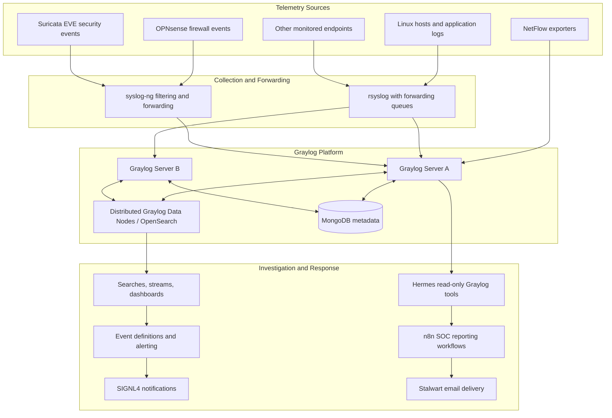

# Graylog Centralized Logging & Security Analytics

> **Project:** Castellum Homelab Security Portfolio  
> **Focus:** Centralized logging, SIEM operations, network-flow analysis, detection engineering, encrypted log transport, and distributed-system troubleshooting  
> **Status:** Actively maintained; the architecture has evolved over time  
> **Publication:** Sanitized public case study — no production IP addresses, internal hostnames, credentials, or private certificates

## Project Overview

Graylog has grown from a place to collect Linux and network logs into one of the most important security platforms in my homelab. I use it to centralize telemetry, investigate activity across multiple networks, search structured events, develop detections, and provide actionable information to notification and automation systems.

This project is particularly valuable to me because it has **not** been a one-time installation. Operating Graylog over an extended period meant dealing with log formats, transport security, cluster membership, search-backend failures, upgrades, storage problems, noisy alerts, and real investigations. Some changes worked immediately; others required hours of examining service logs, comparing node configurations, and validating recovery.

My goal is to document both the architecture and the engineering decisions behind it — including the mistakes and improvements.

## Objectives

- Centralize Linux, firewall, network, application, and security telemetry in a searchable platform.
- Gain hands-on experience with Graylog servers, Data Nodes, MongoDB, and the underlying OpenSearch search layer.
- Support logs from multiple network segments without treating the entire homelab as one trusted network.
- Improve log reliability through appropriate protocols, forwarding queues, and multiple ingestion endpoints.
- Encrypt and authenticate log transport where supported and appropriate.
- Normalize fields so different data sources can support common searches, dashboards, and event definitions.
- Detect high connection rates, potential scanning, and unusual outbound traffic while reducing false positives.
- Extend investigations into notifications and automated SOC-style reporting.
- Practice diagnosing and recovering a multi-node logging service without unnecessarily destroying indexed data.

## Environment and Technologies

| Component | Role in the project |
|---|---|
| Debian Linux | Operating system for logging infrastructure and many log sources |
| Graylog 7.x | Centralized ingestion, searching, streams, dashboards, and event definitions |
| Graylog Server | Log processing, APIs, search, and administrative interface |
| Graylog Data Node / OpenSearch | Distributed indexing, search, shard placement, and replicas |
| MongoDB | Graylog metadata and configuration storage |
| Bare-metal and Docker-based nodes | Mixed deployment approaches used during the project's evolution |
| `rsyslog` | Linux host and application-log forwarding; disk-assisted queues and retry behavior |
| `syslog-ng` | Structured firewall/Suricata event forwarding and filtering |
| OPNsense | Firewall and network-flow telemetry source |
| Suricata | Network security events generated on the firewall |
| NetFlow / ntopng | Network-flow telemetry and complementary traffic visibility |
| SIGNL4 | External alert notification for selected Graylog events |
| Hermes MCP + n8n | Read-only log analysis and SOC-report automation workflows |
| Stalwart | Mail delivery for longer-form operational reports |

**Architecture history:** At different points I operated a main Graylog server, an additional server, and a distributed set of Data Nodes across physical and virtual infrastructure. A secondary Graylog/Data Node was deployed through Docker, while other Data Nodes used native packages. I later adjusted the node layout again. The diagram below therefore shows the **logical architecture**, not a claim that every historical node exists in the same configuration today.

## Architecture



**Diagram notes:** Forwarding arrows depict supported paths and failover-capable destinations, **not** a requirement that each message be duplicated to both servers. Graylog Data Nodes provide a distributed search/indexing layer; a Graylog server and a Data Node are distinct roles. The report/notification paths summarize integrations developed at different stages, rather than asserting that every workflow is continuously healthy.

## Implementation and Evolution

### 1. Building a Central Log Collection Point

I began by collecting logs from Linux systems and networking components so that troubleshooting and security investigations would not require signing into every host individually.

I worked with different message formats and transports, including conventional syslog, structured RFC 5424 messages, and NetFlow records. A practical lesson was that receiving a packet on an input does not automatically mean the resulting message was parsed correctly, assigned to the intended stream, or indexed and searchable.

I learned to verify each stage independently: source generation, forwarding, network transport, Graylog input reception, field parsing, and successful search results.

### 2. Expanding Beyond a Single Node

As I added more sources and retained more data, I expanded the search backend into a multi-node architecture. The environment has included both bare-metal and Docker-based Graylog Data Nodes, with more than one Graylog server during later stages.

This created practical experience with:

- Data Node discovery and cluster-manager elections.
- Distinguishing server-node availability from Data Node/OpenSearch availability.
- Matching versions across Graylog components during upgrades.
- JVM heap sizing and memory-pressure investigation.
- Primary and replica shard health, allocation, and recovery.
- Certificate-based communication between components.
- Understanding why a healthy-looking web interface does not necessarily mean a healthy indexing cluster.

I also learned that a distributed deployment increases resilience **only when cluster health, storage, and recovery procedures are actually verified**.

### 3. Improving Log Forwarding Reliability

Rather than configuring every machine to forward logs the same way, I adapted the collection method to its source and security requirements.

For Linux hosts, I used `rsyslog` forwarding configurations, including a disk-assisted queue and retry behavior on systems where transient outages should not immediately result in discarded messages. Where two Graylog ingestion servers were available, I used a forwarding pool so traffic could be distributed or sent to another target when necessary.

An important detail: **load-balanced forwarding is not the same as deliberately sending every log twice**. I also used dedicated rulesets for selected services, such as PostgreSQL and application-specific logs, to avoid accidental duplicate ingestion caused by overlapping general and specialized forwarding configurations.

### 4. Encrypting Syslog from More Sensitive Segments

I moved selected DMZ-to-Graylog forwarding paths to syslog over TLS.

This involved issuing certificates from my internal certificate authority, installing trusted CA material, configuring the receiving input, and verifying that clients checked the intended server name. I validated connections with OpenSSL rather than assuming that opening a TCP connection proved encryption was working.

A verified test established a TLS 1.3 connection, a trusted certificate chain, and successful hostname verification. On the receiving side, I confirmed actual RFC 5424 events arriving and being parsed into messages.

**Important distinction:** The verified setup used TLS with server-certificate authentication. That does not, by itself, establish mutual TLS on every source. Per-host client certificates were considered as a further hardening step, and I do not claim universal mTLS deployment.

### 5. Bringing Firewall and Suricata Telemetry into Graylog

I integrated OPNsense firewall information and Suricata EVE events with the logging platform. Suricata runs on the firewall, while Graylog provides centralized visibility and investigation rather than serving as the network enforcement point.

For the EVE pipeline, I configured `syslog-ng` to follow JSON event records and forward selected event types. I narrowed the forwarded data to security-relevant categories such as TLS and drop events for the intended collection path, rather than indiscriminately shipping every available record.

I also disabled a redundant Suricata syslog-output path when it risked generating duplicate messages. This reinforced an important lesson: **one authoritative ingestion path per data type is easier to reason about than several overlapping paths**.

Another lesson was to distinguish an **IDS alert**, a **true rule-based IPS drop**, and a **stream-validation or decoder-related drop**. Treating them all as confirmed blocked attacks produces misleading reports.

### 6. Normalizing NetFlow for Searching and Detection

Raw flow fields were not consistent with fields used by my other security data sources. I normalized useful values into a more common structure so searches and event definitions could operate on source/destination addresses, ports, byte counts, and protocol information.

| Raw NetFlow field | Normalized field |
|---|---|
| `nf_ipv4_src_addr` | `src_ip` |
| `nf_ipv4_dst_addr` | `dst_ip` |
| `nf_l4_src_port` | `src_port` |
| `nf_l4_dst_port` | `dst_port` |
| `nf_bytes` | `bytes` |
| `nf_pkts` | `packets` |
| `nf_proto_name` | `protocol` |

I also developed a `flow_tuple` representation for context. Testing confirmed these normalized fields were available in searches, which made aggregation and alerting more useful.

NetFlow is valuable for answering **who communicated with whom, on which ports, and with approximately how much traffic**. It does not, by itself, prove that an application transfer was malicious or reveal the contents of encrypted traffic.

## Detection Engineering and Alert Tuning

I developed and refined Graylog event definitions around recurring security questions:

| Detection | What I wanted to identify | Main limitation / tuning concern |
|---|---|---|
| High Connection Rate | Unusual concentration of connections from one source | Busy but legitimate workloads can generate large connection counts |
| External Scan | Patterns consistent with external reconnaissance | Scanners, monitoring, and blocked background traffic require context |
| Data Exfiltration | Potentially unusual outbound byte volume grouped by source | Large legitimate transfers, VPN paths, and aggregation windows can trigger false positives |

For an outbound-volume detection originally named **Data Exfiltration**, one version of the rule considered private-network sources, excluded some expected destinations/ports, grouped by source IP, and evaluated `sum(bytes) > 50,000,000` over its configured evaluation window. I later added exclusions for known baseline traffic, including authorized camera activity.

That threshold is a **triage heuristic**, not proof of exfiltration. In particular, excluding a common port can reduce noise but also reduce detection coverage. Any suppression or exception needs a documented reason and periodic review.

I connected selected Graylog events to SIGNL4. A high-connection-rate NetFlow event successfully reached the notification service, providing end-to-end confirmation that an event could be generated and delivered beyond the Graylog interface.

## Significant Problems and Investigations

### Case Study 1 — Data Node Would Not Start After an Upgrade / Restart

**Symptoms:** A Docker-based Data Node entered a restart loop. Logs indicated local OpenSearch/Lucene state problems, including missing `segments*` files and `IndexNotFoundException` during a data-directory compatibility check.

**Investigation:** I examined the container logs, mounted data directory, ownership, and the health of the remaining Data Nodes. The critical decision was to verify that other copies of the indexed data remained available before touching the affected node's local storage.

**Resolution:** I reset the affected node's local search data only after checking the replicated cluster state, corrected the persistent directory ownership as needed, and rejoined the node. The deployment recovered and the node became usable again.

**Lesson:** Container re-creation does not fix corrupt persistent state. At the same time, deleting a Data Node directory without checking shard replicas and recovery options can cause permanent data loss. **Replica availability must be established first.**

### Case Study 2 — JVM Crash, Port Conflict, and Lucene Corruption

**Symptoms:** A native Data Node experienced a JVM abort. During recovery, an orphaned Java process still occupied a cluster transport port, and additional OpenSearch/Lucene checksum errors affected search shards.

**Investigation:** I checked systemd status, process ownership, listening sockets, journal output, and shard status. A straightforward service restart was insufficient because the underlying process and on-disk state had to be accounted for.

**Resolution:** I isolated the affected search-node state, resolved the process/port conflict, and worked through shard recovery and cluster rejoining. A subsequent restart of another Data Node completed the recovery path.

**Validated result:** On a July 2026 recovery check, the cluster was **green with three nodes, 230 active shards, and zero unassigned shards**. That is a historical validation snapshot, not a claim about today's shard count.

**Lesson:** Recovery should be driven by evidence from cluster health, shard allocation, and service logs — not only by whether the daemon starts.

### Case Study 3 — Cluster Discovery and Version Mismatches

**Symptoms:** At different points, nodes failed to discover a cluster manager, search services were not listening even when the Data Node management API was available, and mixed component versions appeared during upgrades.

**Investigation:** I compared deployed package/container versions, OpenSearch discovery addresses, node roles, JVM startup logs, network listeners, and the cluster's reported health. Some version-specific JDK paths also changed after an upgrade, making older diagnostic commands unreliable.

**Resolution:** I aligned the appropriate component versions, corrected node configuration where required, and validated successful cluster formation after upgrades. In one September 2026 checkpoint, the distributed search cluster showed **264 active shards and no initializing, relocating, or unassigned shards**.

**Lesson:** A distributed logging platform is a coordinated set of services. Server version, Data Node version, certificates, cluster discovery, Java runtime behavior, and retained state can all affect availability.

### Case Study 4 — TLS Worked, but Delivery Timing Still Needed Investigation

**Symptoms:** A DMZ source could establish a verified TLS connection and Graylog accepted properly parsed messages, yet a review of sample messages showed an approximately **111-second ingestion delay**.

**Investigation:** I distinguished transport verification from delivery latency by checking both the TLS handshake and the timestamps on the records arriving in Graylog.

**Outcome:** Encryption, trust verification, and message reception were confirmed. The precise cause of the observed timing difference was **not established at that checkpoint**.

**Lesson:** A successful TLS handshake proves neither timely delivery nor complete ingestion. Latency and loss require their own validation.

### Case Study 5 — A Data-Exfiltration Alert Was Legitimate Plex Traffic

**Symptoms:** An outbound-volume alert identified a large transfer from a homelab media service.

**Investigation:** I traced the source, destination, ports, byte count, flow duration, and known VPN activity. The flow was approximately **134 MB over five minutes** and corresponded to authorized Plex streaming over a WireGuard connection.

**Resolution:** I treated the activity as an explainable false positive and used the investigation to improve how alert context and baseline exceptions were handled, rather than labeling an ordinary transfer as malicious.

**Lesson:** A flow volume threshold is useful for surfacing behavior, but **context determines whether it is suspicious**. VPN clients, media streaming, backup transfers, and other high-volume services must be evaluated before escalation.

### Case Study 6 — Duplicate Logs and Source-Side Filtering

**Symptoms:** Overlapping forwarding configurations created a risk of duplicate messages and noisy ingestion, particularly when a service's specialized log forwarding coexisted with general syslog forwarding.

**Investigation:** I followed the source log, forwarding ruleset, transport destination, and receiving input, rather than assuming duplicates were generated by Graylog itself.

**Resolution:** I separated specialized logging rulesets where appropriate and disabled redundant Suricata output paths. For selected EVE data I restricted forwarded event categories to the types required for investigation.

**Lesson:** Data quality starts at the source. Removing duplicate collection paths is often more effective than trying to repair duplicated records after indexing.

## SOC Automation and Reporting

A later phase of the project extended Graylog beyond dashboards and manual searches.

I integrated **Hermes**, a read-only Graylog MCP interface, into an automation workflow through **n8n**. This allowed structured searches and aggregations to contribute to SOC-style summaries. The integration grew to expose multiple Graylog tools, and I worked through network access and API authentication issues between the gateway and the automation host.

One practical issue was report length: short notifications were unsuitable for detailed findings. I moved toward delivery through **Stalwart email**, which can carry a fuller report without the same message-length constraints as a push-notification channel.

I also learned that automated investigations require strong guardrails. My reporting instructions distinguish:

- Firewall blocks from confirmed IDS/IPS prevention.
- Known repetitive activity from new or corroborated threats.
- Raw event counts from validated aggregates.
- Flow byte counts from proof of data exfiltration.
- Missing data from evidence that no event occurred.

**Operational limitation:** Some long-running gateway/automation requests have timed out. I treat those as workflow reliability problems to investigate, not as evidence that scheduled reporting is permanently solved.

## Troubleshooting and Validation Approach

I now validate Graylog changes layer by layer:

1. **Source:** Verify the application, firewall, or host actually produces the expected record.
2. **Forwarder:** Validate `rsyslog`/`syslog-ng` syntax, queue behavior, and service health.
3. **Transport:** Confirm packet delivery and TLS trust/hostname validation where applicable.
4. **Input:** Confirm that the correct Graylog input receives messages.
5. **Processing:** Check parsing, normalized fields, stream routing, and timestamps.
6. **Indexing:** Verify Data Node health and that messages are searchable.
7. **Detection:** Test event definitions using known traffic and confirm grouping and aggregation values.
8. **Notification:** Validate the downstream delivery independently of the alert being visible in Graylog.

Useful commands from this workflow include:

```bash
sudo rsyslogd -N1
sudo syslog-ng --syntax-only
sudo systemctl status graylog-server graylog-datanode --no-pager
sudo journalctl -u graylog-datanode -n 100 --no-pager
sudo ss -ltnp
```

For TLS troubleshooting, I use `openssl s_client` with the expected certificate name and trusted CA, while checking the sender's forwarding logs and the corresponding messages in Graylog. I also inspect OpenSearch cluster and shard health through authenticated administrative tools, without publishing API credentials or internal endpoints.

**Safety note:** Past recovery work occasionally required deleting or quarantining a node's local search data. Those were case-specific recovery decisions after checking replica availability, not general-purpose repair instructions.

## Outcomes and Evidence

| Result | Evidence or qualification |
|---|---|
| Centralized, searchable logs | Multiple Linux, network, firewall, and application sources brought into Graylog |
| Distributed search architecture | Graylog servers and multiple Data Nodes operated across native and containerized deployments |
| Search-cluster recovery | Verified historical green cluster, three nodes / 230 active shards / zero unassigned (July 2026) |
| Upgrade validation | Verified historical snapshot with 264 active shards / zero unassigned (September 2026) |
| Encrypted DMZ log transport | TLS 1.3, trusted internal CA, certificate-name verification, and parsed RFC 5424 records |
| Normalized traffic fields | NetFlow source, destination, port, protocol, packet and byte fields available for detection |
| Working external notification | Graylog high-connection event delivered to SIGNL4 |
| Better false-positive triage | Plex-over-WireGuard traffic investigated before escalation |
| Extended security analysis | Hermes + n8n SOC-style reporting integrated, with timeout/length limits identified |

These are **selected operating and troubleshooting milestones**, not a guarantee of current uptime, zero packet loss, full high availability, or complete detection coverage.

## Skills Demonstrated

- Centralized logging and SIEM administration.
- Linux systems administration and service troubleshooting.
- Multi-node OpenSearch/Data Node clustering, upgrades, and recovery.
- Log transport with syslog, TLS, `rsyslog`, and `syslog-ng`.
- PKI trust-chain and certificate-name verification.
- NetFlow parsing, field normalization, aggregation, and traffic analysis.
- Security stream design, event definitions, and alert tuning.
- False-positive triage and evidence-based incident investigation.
- Monitoring data quality, duplication, and ingestion latency.
- Automation integration, notifications, and SOC reporting.
- Clear separation of observed evidence, inference, and unresolved issues.

## Lessons Learned

**A working dashboard is not proof of a healthy logging pipeline.** A source can stop forwarding, an input can misparse messages, or a Data Node can fail to index records while parts of the interface remain reachable.

**Redundancy must be tested, not assumed.** Replicas and additional servers create recovery options, but only if they are healthy and the operator understands where data and application state live.

**Storage is operationally critical.** Persistent search data, permissions, Lucene segment integrity, and shard placement all matter. Deleting data directories is especially dangerous without a verified recovery path.

**Security transport has multiple layers.** Encryption, certificate trust, correct hostname verification, timely delivery, and successful parsing are separate checks.

**Alert volume is not detection quality.** A successful detection identifies something worth investigating, but investigation is what establishes context. I learned to tune expected traffic without creating undocumented blind spots.

**Automation needs evidence limits.** A generated security briefing is only as trustworthy as the queries, fields, time windows, and conclusions behind it. An unavailable log source should be reported as a visibility gap, not a clean bill of health.

This project has been one of my best practical exercises in operating security infrastructure as a **living system**: designing it, breaking it, restoring it, testing it, and improving it over time.

## Related Portfolio Pages

- [Network Architecture](../architecture/network-design.md)
- [VLAN Segmentation](../architecture/vlan-segmentation.md)
- [Wazuh SIEM/XDR](wazuh.md)
- [Service Catalog](../service-catalog.md)

## Technical References

- [Graylog — The Graylog Stack](https://go2docs.graylog.org/current/planning_your_deployment/the_graylog_stack.htm)
- [Graylog — Inputs](https://go2docs.graylog.org/current/getting_in_log_data/inputs.htm)
- [Graylog — Event Definitions](https://go2docs.graylog.org/current/interacting_with_your_log_data/event_definitions.html)

*The technical references describe general product concepts. The project history, incidents, and validation snapshots above describe my homelab experience; exact component versions and topology have changed over time.*
